# Low Poly City Kit: 129 free CC0 low poly 3D models for city builders

🇬🇧 English · **🇧🇷 [Leia em português](README.pt-BR.md)**

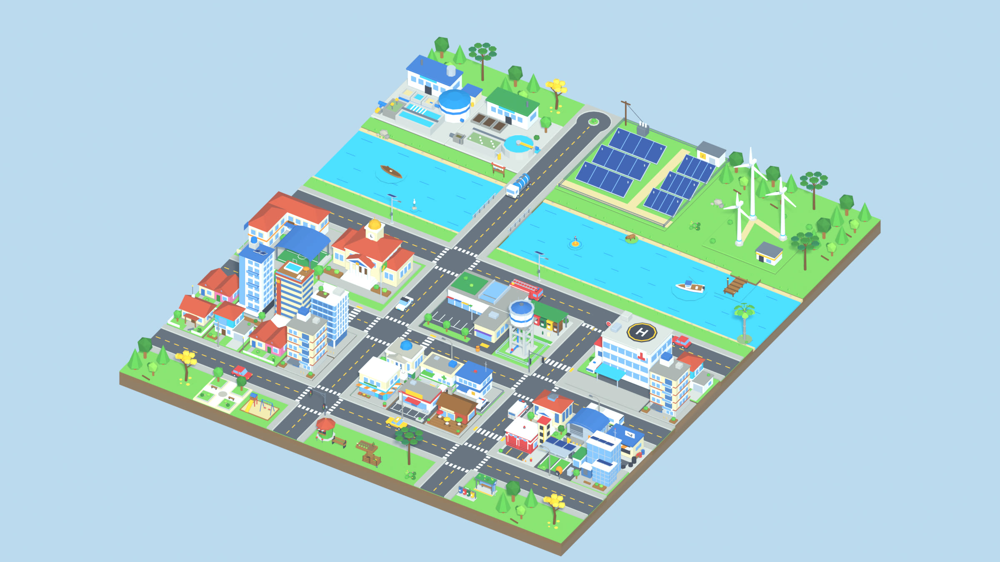

> **Short answer:** the Low Poly City Kit (*Kit Cidade Low Poly*) is a **free, public domain (CC0 1.0)** pack of
> **129 low poly 3D models in glTF/GLB** for building cities in games and visualizations: houses, shops, public
> services, water and sanitation, renewable energy, waste and recycling, parks, modular road and terrain tiles
> (2 × 2), vehicles, street furniture, Brazilian native trees (yellow ipê, araucaria, buriti palm) and riverside
> props. Flat colors, no textures, at most 1,500 triangles per model. Works in Godot, Unity, Unreal, three.js,
> Babylon.js and Blender. Commercial use is allowed and attribution is optional.

Free **low poly 3D models** for building cities: houses, commercial buildings, public services, water and
sanitation, energy, waste, parks, modular roads and terrain, vehicles, street furniture, Brazilian native
vegetation and riverside props. Everything is **binary glTF (`.glb`)** with flat colors and no textures, ready for
Godot, Unity, Unreal Engine, Babylon.js, three.js, Blender and more. Great for **city builders, tycoon and
simulation games, educational games, isometric game prototypes, game jams and architectural mockups**.

**Public domain ([CC0 1.0](LICENSE)).** Use it however you like, in personal, educational or commercial
projects; modify and redistribute it. Attribution is optional (see [CITATION.cff](CITATION.cff)). No warranty.

**Contents:** [How to use](#how-to-use) · [Catalog](#catalog) · [Build or modify](#build-or-modify-the-models) ·
[FAQ](#faq) · [Origin and credits](#origin-and-credits)

> File and folder names are in Portuguese (for example `residencial/casa_simples.glb` = small house). The catalog
> below lists every file with its English name.

## How to use

- Download the repository (**Code → Download ZIP**) or just the `.glb` files you need from [`models/`](models).
- **Scale and grid:** 1 lot = 2 × 2 units. Buildings take N × N lots; road and terrain pieces are exactly
  2 × 2 tiles that snap side by side; vehicles, props and street furniture use a "toy" scale that matches the lots.
- **Orientation:** Y up, model front facing **-Z** (glTF convention).
- **Materials:** one material per color (PBR, base color only, roughness 0.85). To batch everything into a
  single draw call, convert material colors into vertex colors in your engine.
- **Animatable parts:** objects named `pas_N` (rotors, spin around the hub axis) and `gira_N` (spin upright)
  are kept separate from the body, with the pivot in place.
- **Budget:** at most 1,500 triangles and 150 KB per model.

### Modular roads and terrain

Pieces in `ruas/` (roads) and `terreno/` (terrain) cover exactly x, z ∈ [-1, 1] and snap to a 2-unit grid,
rotating in 90° steps around Y. Measurements in glTF space (Y up):

| Element | Measurement |
|---|---|
| Terrain block | y -0.3 to 0 (grass top at 0); road tiles already include the block below and **replace** the terrain tile |
| Asphalt | 1.3 wide, centered (\|x\| ≤ 0.65), top at y 0.04, dashed yellow center line |
| Curb and sidewalk | curb top at 0.075; sidewalk from \|x\| 0.65 to 1.0, top at 0.07 |
| Dirt road | same width as asphalt, top at y 0.02, no sidewalk |
| Water | surface at y -0.12; sand bank step at y -0.06 |
| Hill | top at y 0.6; `rampa` (ramp) rises from 0 (-Z edge) to 0.6 (+Z edge) |

Connections without rotation: `asfalto_reta`, `asfalto_faixa_pedestre`, `terra_reta` and `ponte` connect -Z and
+Z; `asfalto_curva` and `terra_curva` connect -Z and -X; `asfalto_t` connects -Z, +Z and -X; `asfalto_ponta`
only -Z; `estacionamento` (parking lot) opens to -Z; `margem_reta` (riverbank) has water on the -Z half;
`margem_canto` has water in a quarter circle at the (+X, -Z) corner. See a sample neighborhood in
[`src/cena_cidade.py`](src/cena_cidade.py).

## Catalog

<!-- catalogo:inicio -->
**129 models** in 14 categories.

### Residential · Residencial (5)

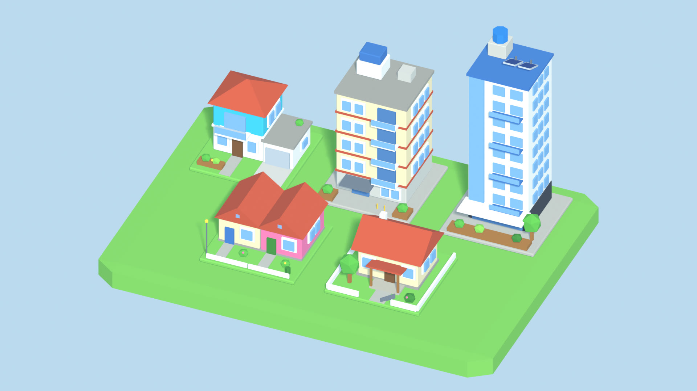

| | Model | Description | Tris |
|---|---|---|---:|
| 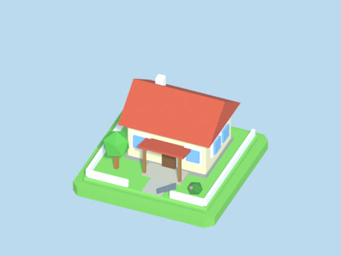 | [`casa_simples`](models/residencial/casa_simples.glb) | Small house (1×1) | 584 |
| 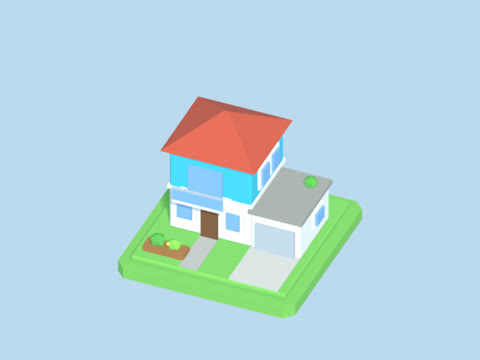 | [`casa_sobrado`](models/residencial/casa_sobrado.glb) | Two-story house (1×1) | 564 |
| 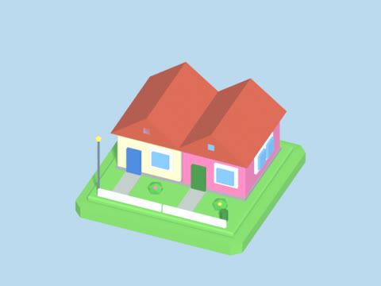 | [`casas_geminadas`](models/residencial/casas_geminadas.glb) | Semi-detached houses (1×1) | 588 |
| 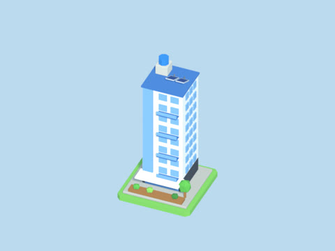 | [`predio_alto`](models/residencial/predio_alto.glb) | Residential high-rise (1×1) | 1008 |
| 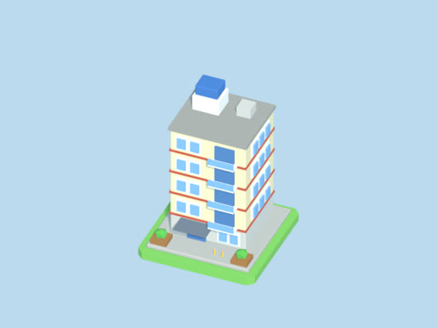 | [`predio_apartamentos`](models/residencial/predio_apartamentos.glb) | Apartment building (1×1) | 1208 |

### Commercial · Comércio (8)

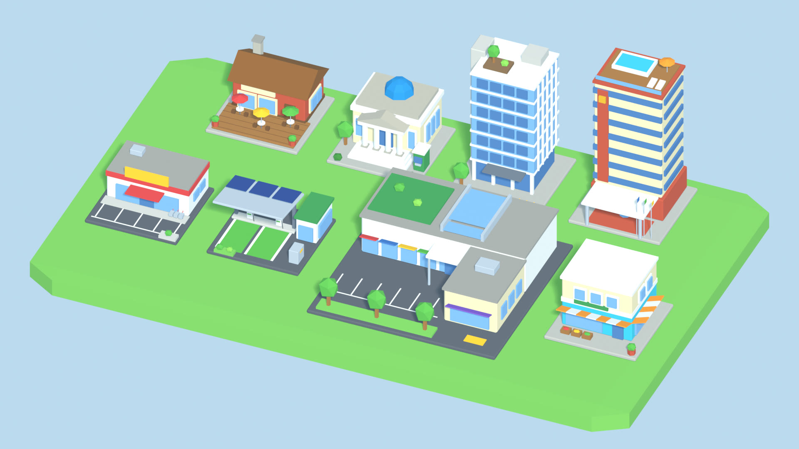

| | Model | Description | Tris |
|---|---|---|---:|
| 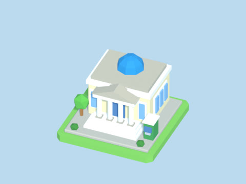 | [`banco`](models/comercial/banco.glb) | Bank branch (1×1) | 662 |
| 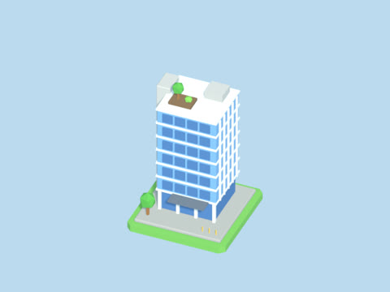 | [`escritorio`](models/comercial/escritorio.glb) | Office building (1×1) | 820 |
| 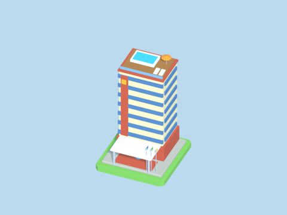 | [`hotel`](models/comercial/hotel.glb) | Hotel (1×1) | 678 |
| 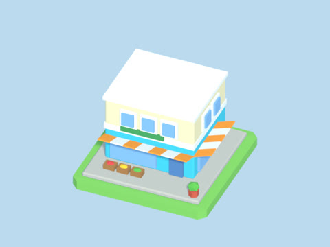 | [`loja_esquina`](models/comercial/loja_esquina.glb) | Corner shop (1×1) | 652 |
| 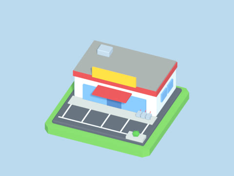 | [`mercado`](models/comercial/mercado.glb) | Neighborhood grocery store (1×1) | 512 |
| 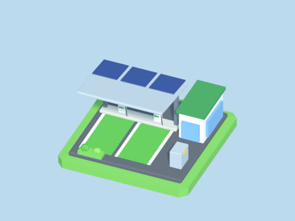 | [`posto_recarga`](models/comercial/posto_recarga.glb) | Electric car charging station (1×1) | 636 |
| 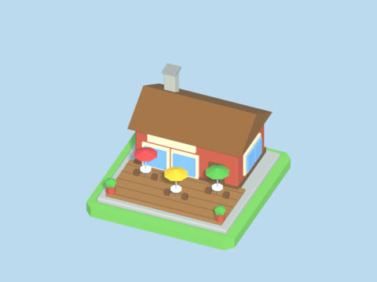 | [`restaurante`](models/comercial/restaurante.glb) | Restaurant (1×1) | 738 |
| 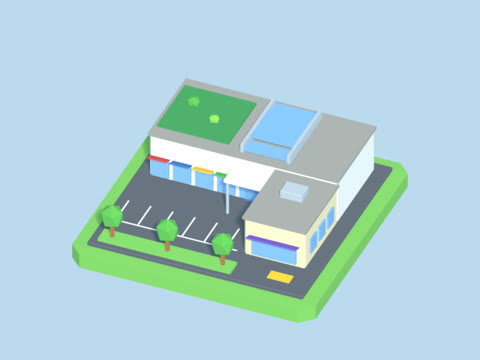 | [`shopping`](models/comercial/shopping.glb) | Shopping mall (2×2) | 796 |

### Public services · Serviços públicos (12)

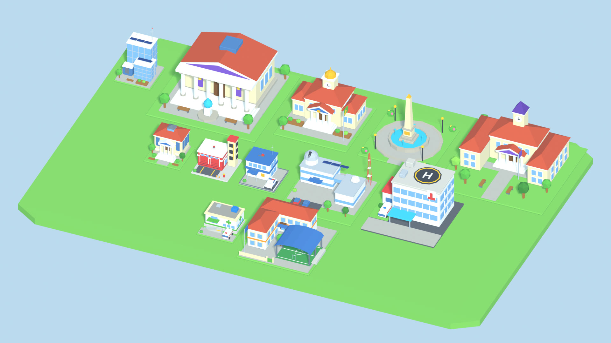

| | Model | Description | Tris |
|---|---|---|---:|
| 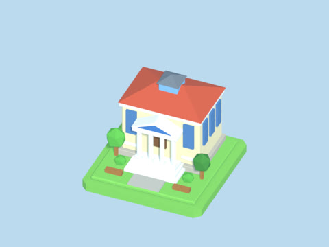 | [`biblioteca`](models/publicos/biblioteca.glb) | Public library (1×1) | 812 |
| 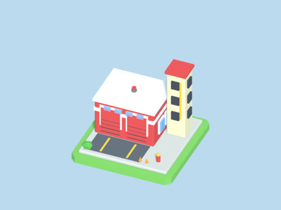 | [`bombeiros`](models/publicos/bombeiros.glb) | Fire station (1×1) | 670 |
| 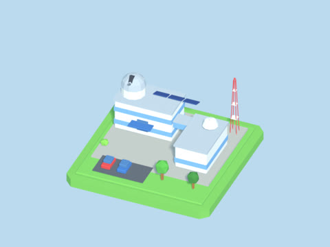 | [`centro_pesquisa`](models/publicos/centro_pesquisa.glb) | Research center (2×2) | 952 |
| 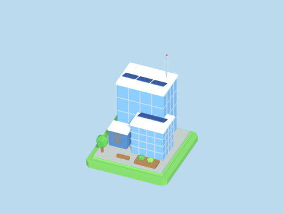 | [`centro_tecnologia`](models/publicos/centro_tecnologia.glb) | Technology center (1×1) | 686 |
| 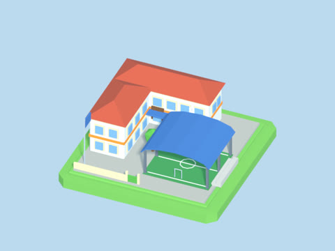 | [`escola`](models/publicos/escola.glb) | School (2×2) | 1328 |
|  | [`hospital`](models/publicos/hospital.glb) | Hospital (2×2) | 1224 |
| 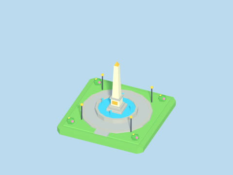 | [`monumento`](models/publicos/monumento.glb) | Historic monument (2×2) | 1154 |
| 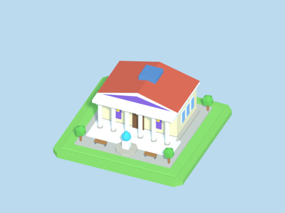 | [`museu`](models/publicos/museu.glb) | Museum (3×3) | 1238 |
| 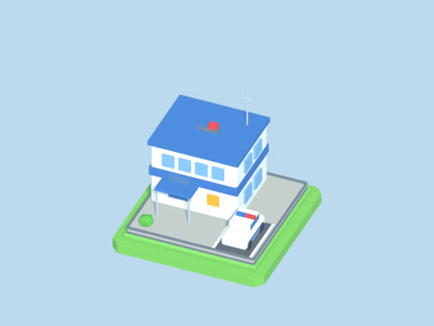 | [`policia`](models/publicos/policia.glb) | Police station (1×1) | 772 |
| 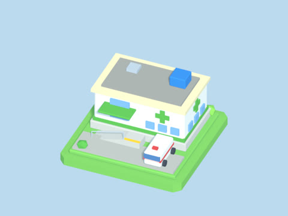 | [`posto_saude`](models/publicos/posto_saude.glb) | Health clinic (1×1) | 724 |
| 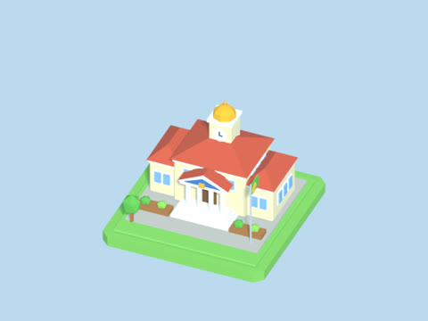 | [`prefeitura`](models/publicos/prefeitura.glb) | City hall (2×2) | 1146 |
| 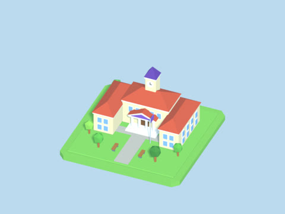 | [`universidade`](models/publicos/universidade.glb) | University (3×3) | 1352 |

### Industry · Indústria (4)

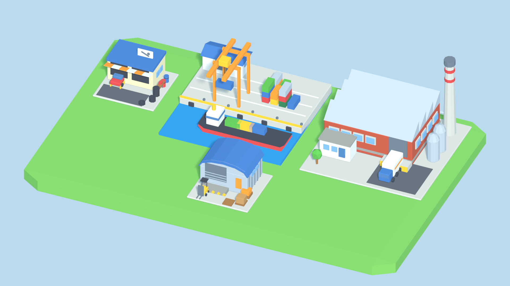

| | Model | Description | Tris |
|---|---|---|---:|
| 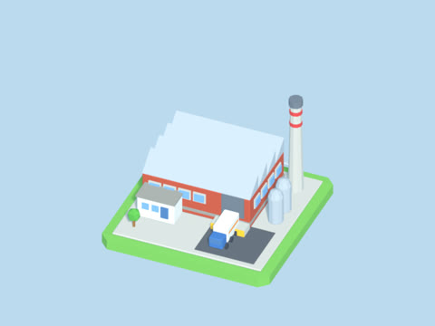 | [`fabrica`](models/industrial/fabrica.glb) | Factory (2×2) | 1372 |
| 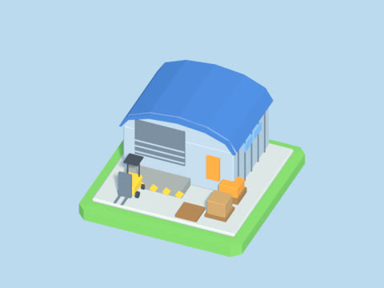 | [`galpao`](models/industrial/galpao.glb) | Warehouse (1×1) | 748 |
| 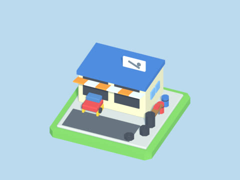 | [`oficina`](models/industrial/oficina.glb) | Car repair shop (1×1) | 1164 |
| 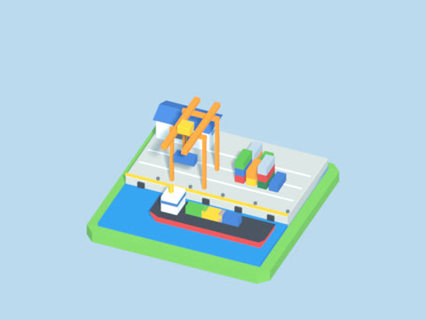 | [`porto`](models/industrial/porto.glb) | Port (2×2, on water) | 1020 |

### Water and sanitation · Água e saneamento (16)

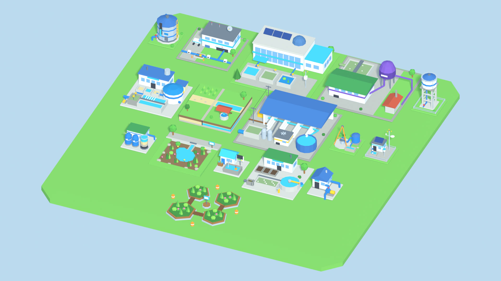

| | Model | Description | Tris |
|---|---|---|---:|
| 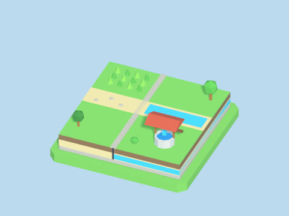 | [`barragem_subterranea`](models/agua/barragem_subterranea.glb) | Underground dam (2×2) | 592 |
| 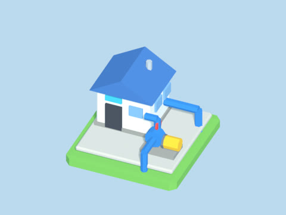 | [`bomba_agua`](models/agua/bomba_agua.glb) | Water pump station (1×1) | 440 |
| 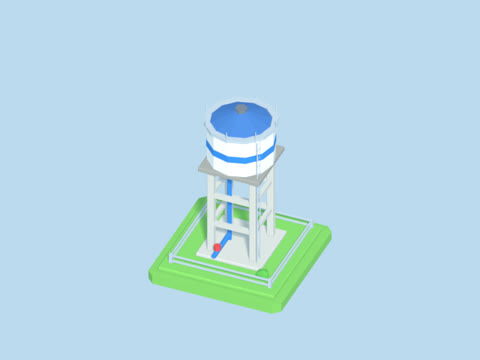 | [`caixa_dagua`](models/agua/caixa_dagua.glb) | Elevated water tower (1×1) | 1232 |
| 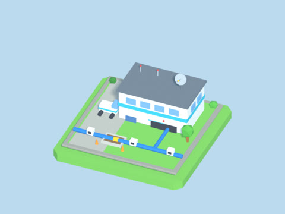 | [`centro_controle_perdas`](models/agua/centro_controle_perdas.glb) | Water loss control center (2×2) | 964 |
| 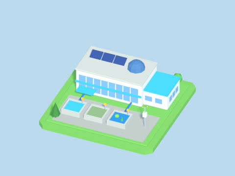 | [`centro_pesquisa_agua`](models/agua/centro_pesquisa_agua.glb) | Water research center (3×3) | 1112 |
| 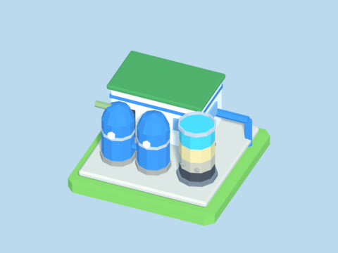 | [`estacao_filtragem`](models/agua/estacao_filtragem.glb) | Filtration station (1×1) | 984 |
| 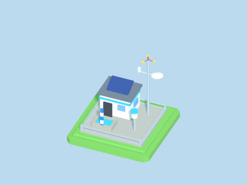 | [`estacao_monitoramento`](models/agua/estacao_monitoramento.glb) | Monitoring station (1×1) | 684 |
| 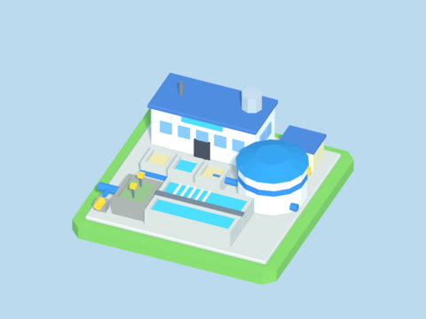 | [`eta`](models/agua/eta.glb) | Water treatment plant (2×2) | 1268 |
| 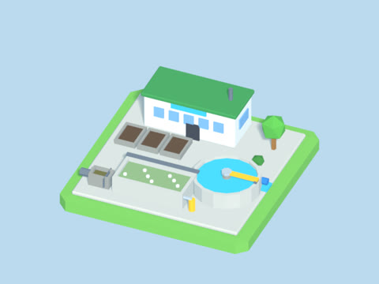 | [`ete`](models/agua/ete.glb) | Sewage treatment plant (2×2) | 1232 |
| 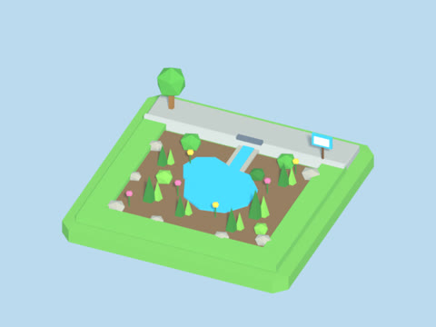 | [`jardim_chuva`](models/agua/jardim_chuva.glb) | Rain garden (2×2) | 776 |
| 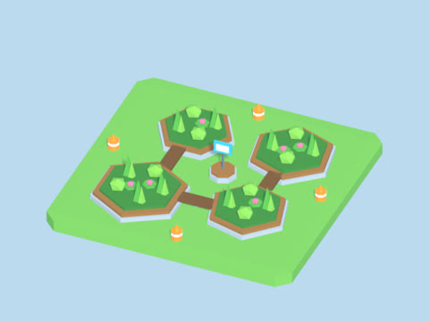 | [`jardim_flutuante`](models/agua/jardim_flutuante.glb) | Floating garden (3×3, on water) | 1212 |
| 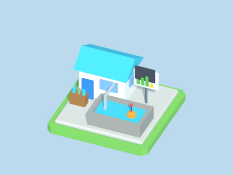 | [`monitor_qualidade_agua`](models/agua/monitor_qualidade_agua.glb) | Water quality monitor (1×1) | 508 |
| 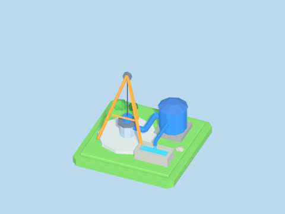 | [`poco_artesiano`](models/agua/poco_artesiano.glb) | Artesian well (1×1) | 656 |
| 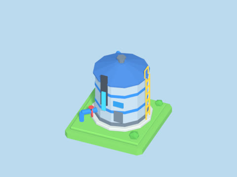 | [`reservatorio`](models/agua/reservatorio.glb) | Water reservoir (1×1) | 868 |
| 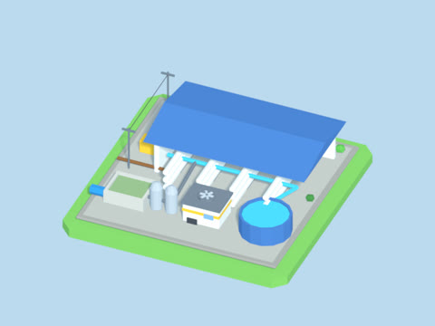 | [`usina_dessalinizacao`](models/agua/usina_dessalinizacao.glb) | Desalination plant (3×3) | 1468 |
| 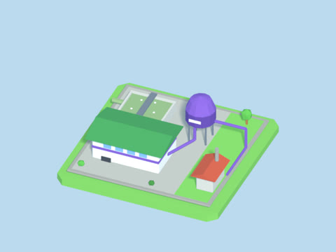 | [`usina_reuso_agua`](models/agua/usina_reuso_agua.glb) | Water reuse plant (3×3) | 938 |

### Energy · Energia (11)


| | Model | Description | Tris |
|---|---|---|---:|
|  | [`biodigestor`](models/energia/biodigestor.glb) | Biodigester (2×2) | 1408 |
|  | [`hidreletrica`](models/energia/hidreletrica.glb) | Hydroelectric dam (3×3, on water) | 972 |
|  | [`parque_eolico`](models/energia/parque_eolico.glb) | Wind farm (2×2) | 846 |
|  | [`poste_energia`](models/energia/poste_energia.glb) | Power line pole (1×1) | 264 |
|  | [`termeletrica`](models/energia/termeletrica.glb) | Thermal power plant (2×2) | 844 |
|  | [`usina_biomassa`](models/energia/usina_biomassa.glb) | Biomass power plant (2×2) | 1056 |
|  | [`usina_cana`](models/energia/usina_cana.glb) | Sugarcane ethanol and bioenergy mill (3×3) | 1440 |
|  | [`usina_carvao`](models/energia/usina_carvao.glb) | Coal power plant (2×2) | 512 |
|  | [`usina_mare`](models/energia/usina_mare.glb) | Tidal power plant (2×2, on water) | 640 |
|  | [`usina_nuclear`](models/energia/usina_nuclear.glb) | Nuclear power plant (4×4) | 1488 |
|  | [`usina_solar`](models/energia/usina_solar.glb) | Solar farm (3×3) | 944 |

### Waste and recycling · Resíduos (4)


| | Model | Description | Tris |
|---|---|---|---:|
|  | [`aterro_sanitario`](models/residuos/aterro_sanitario.glb) | Sanitary landfill (3×3) | 1482 |
|  | [`cooperativa_reciclagem`](models/residuos/cooperativa_reciclagem.glb) | Recycling cooperative (2×2) | 1302 |
|  | [`patio_compostagem`](models/residuos/patio_compostagem.glb) | Composting yard (2×2) | 1158 |
|  | [`ponto_coleta`](models/residuos/ponto_coleta.glb) | Recycling drop-off point (1×1) | 832 |

### Parks · Parques (5)


| | Model | Description | Tris |
|---|---|---|---:|
|  | [`ecoparque`](models/parques/ecoparque.glb) | Eco park (3×3) | 1480 |
|  | [`parede_verde`](models/parques/parede_verde.glb) | Green wall (1×1) | 876 |
|  | [`parque`](models/parques/parque.glb) | Tourist park (4×4) | 1484 |
|  | [`parque_linear`](models/parques/parque_linear.glb) | Linear park (3×3) | 900 |
|  | [`telhado_verde`](models/parques/telhado_verde.glb) | Green roof building (2×2) | 1332 |

### Roads (modular 2 × 2 tiles) · Ruas (peças modulares 2 × 2) (12)


| | Model | Description | Tris |
|---|---|---|---:|
|  | [`asfalto_cruzamento`](models/ruas/asfalto_cruzamento.glb) | Asphalt crossroads (2×2 tile) | 492 |
|  | [`asfalto_curva`](models/ruas/asfalto_curva.glb) | Curved asphalt road (2×2 tile) | 548 |
|  | [`asfalto_faixa_pedestre`](models/ruas/asfalto_faixa_pedestre.glb) | Straight asphalt road with crosswalk (2×2 tile) | 228 |
|  | [`asfalto_ponta`](models/ruas/asfalto_ponta.glb) | Dead end with turnaround (2×2 tile) | 524 |
|  | [`asfalto_reta`](models/ruas/asfalto_reta.glb) | Straight asphalt road (2×2 tile) | 132 |
|  | [`asfalto_t`](models/ruas/asfalto_t.glb) | Asphalt T-junction (2×2 tile) | 264 |
|  | [`calcada`](models/ruas/calcada.glb) | Sidewalk (2×2 tile) | 108 |
|  | [`estacionamento`](models/ruas/estacionamento.glb) | Parking lot (2×2 tile) | 320 |
|  | [`ponte`](models/ruas/ponte.glb) | Concrete bridge (2×2 tile, replaces a water tile) | 428 |
|  | [`praca`](models/ruas/praca.glb) | Town square (2×2 tile) | 496 |
|  | [`terra_curva`](models/ruas/terra_curva.glb) | Curved dirt road (2×2 tile) | 484 |
|  | [`terra_reta`](models/ruas/terra_reta.glb) | Straight dirt road (2×2 tile) | 160 |

### Terrain (modular 2 × 2 tiles) · Terreno (peças modulares 2 × 2) (9)


| | Model | Description | Tris |
|---|---|---|---:|
|  | [`agua`](models/terreno/agua.glb) | Water (2×2 tile) | 48 |
|  | [`areia`](models/terreno/areia.glb) | Sand (2×2 tile) | 90 |
|  | [`arvores_mata`](models/terreno/arvores_mata.glb) | Forest (2×2 tile) | 208 |
|  | [`grama`](models/terreno/grama.glb) | Grass (2×2 tile) | 24 |
|  | [`margem_canto`](models/terreno/margem_canto.glb) | Riverbank corner (2×2 tile) | 320 |
|  | [`margem_reta`](models/terreno/margem_reta.glb) | Straight riverbank (2×2 tile) | 148 |
|  | [`morro`](models/terreno/morro.glb) | Hill (2×2 tile) | 108 |
|  | [`rampa`](models/terreno/rampa.glb) | Terrain ramp (2×2 tile) | 56 |
|  | [`terra`](models/terreno/terra.glb) | Packed dirt (2×2 tile) | 144 |

### Vehicles · Veículos (10)


| | Model | Description | Tris |
|---|---|---|---:|
|  | [`ambulancia`](models/veiculos/ambulancia.glb) | Ambulance (van) | 624 |
|  | [`bicicleta`](models/veiculos/bicicleta.glb) | Bicycle | 332 |
|  | [`caminhao`](models/veiculos/caminhao.glb) | Box truck | 676 |
|  | [`caminhao_bombeiros`](models/veiculos/caminhao_bombeiros.glb) | Fire truck | 1028 |
|  | [`caminhao_lixo`](models/veiculos/caminhao_lixo.glb) | Garbage truck (compactor) | 616 |
|  | [`caminhao_pipa`](models/veiculos/caminhao_pipa.glb) | Water tanker truck | 856 |
|  | [`carro`](models/veiculos/carro.glb) | Red hatchback car | 464 |
|  | [`carro_eletrico`](models/veiculos/carro_eletrico.glb) | Electric car | 488 |
|  | [`onibus`](models/veiculos/onibus.glb) | City bus | 616 |
|  | [`taxi`](models/veiculos/taxi.glb) | Taxi | 520 |

### Street furniture · Mobiliário urbano (20)


| | Model | Description | Tris |
|---|---|---|---:|
|  | [`banco_praca`](models/mobiliario/banco_praca.glb) | Park bench | 420 |
|  | [`barril_chuva`](models/mobiliario/barril_chuva.glb) | Rain barrel | 672 |
|  | [`bebedouro`](models/mobiliario/bebedouro.glb) | Public drinking fountain | 472 |
|  | [`bicicletario`](models/mobiliario/bicicletario.glb) | Bike rack | 476 |
|  | [`cerca_madeira`](models/mobiliario/cerca_madeira.glb) | Wooden fence (2-unit section along X) | 348 |
|  | [`cisterna`](models/mobiliario/cisterna.glb) | Precast concrete rainwater cistern (semi-arid) | 600 |
|  | [`hidrante`](models/mobiliario/hidrante.glb) | Fire hydrant | 422 |
|  | [`lixeira`](models/mobiliario/lixeira.glb) | Sidewalk trash bin | 284 |
|  | [`lixeira_seletiva`](models/mobiliario/lixeira_seletiva.glb) | Recycling bins | 936 |
|  | [`orelhao`](models/mobiliario/orelhao.glb) | Brazilian public phone booth (orelhão) | 276 |
|  | [`parquinho`](models/mobiliario/parquinho.glb) | Playground | 596 |
|  | [`placa_educativa`](models/mobiliario/placa_educativa.glb) | Riverside educational sign | 274 |
|  | [`placa_pare`](models/mobiliario/placa_pare.glb) | Stop sign | 136 |
|  | [`ponto_onibus`](models/mobiliario/ponto_onibus.glb) | Bus stop with green roof | 480 |
|  | [`poste_luz`](models/mobiliario/poste_luz.glb) | Street light | 236 |
|  | [`poste_solar`](models/mobiliario/poste_solar.glb) | Solar street light | 320 |
|  | [`quiosque`](models/mobiliario/quiosque.glb) | Park kiosk | 462 |
|  | [`semaforo`](models/mobiliario/semaforo.glb) | Traffic light | 480 |
|  | [`semaforo_pedestre`](models/mobiliario/semaforo_pedestre.glb) | Pedestrian traffic light | 212 |
|  | [`vaso_planta`](models/mobiliario/vaso_planta.glb) | Concrete sidewalk planter | 328 |

### Vegetation · Vegetação (7)


| | Model | Description | Tris |
|---|---|---|---:|
|  | [`araucaria`](models/vegetacao/araucaria.glb) | Araucaria (Paraná pine) | 548 |
|  | [`arbustos`](models/vegetacao/arbustos.glb) | Shrub cluster for flower beds | 200 |
|  | [`buriti`](models/vegetacao/buriti.glb) | Buriti palm (moriche palm) | 636 |
|  | [`composteira`](models/vegetacao/composteira.glb) | Two-bay wooden slat compost bin | 1332 |
|  | [`horta`](models/vegetacao/horta.glb) | Community vegetable garden bed | 494 |
|  | [`ipe_amarelo`](models/vegetacao/ipe_amarelo.glb) | Yellow ipê (Brazilian trumpet tree) | 388 |
|  | [`pedras`](models/vegetacao/pedras.glb) | Riverside rock cluster | 108 |

### Riverside · Beira-rio (6)


| | Model | Description | Tris |
|---|---|---|---:|
|  | [`barco_pesca`](models/beira_rio/barco_pesca.glb) | Small motor fishing boat on a patch of water | 412 |
|  | [`boia_rio`](models/beira_rio/boia_rio.glb) | River monitoring buoy | 364 |
|  | [`canoa`](models/beira_rio/canoa.glb) | Wooden fishing canoe in a river backwater | 296 |
|  | [`capivara`](models/beira_rio/capivara.glb) | Stylized capybara on a patch of riverbank grass | 300 |
|  | [`garca`](models/beira_rio/garca.glb) | Great egret standing on a riverside rock | 222 |
|  | [`trapiche`](models/beira_rio/trapiche.glb) | Short wooden pier (jetty) | 570 |

<!-- catalogo:fim -->

## Build or modify the models

Every model is a short Python script in `src/<category>/<id>.py` that uses the building blocks in
[`src/lib.py`](src/lib.py) (boxes, cylinders, pipes, roofs, windows, trees…) and a single shared color palette.
Requires Blender 4.5 LTS.

```bash
blender -b --factory-startup --python src/agua/eta.py                 # one model → models/agua/eta.glb
blender -b --factory-startup --python src/gerar_todos.py              # all models (+ models/catalogo.json)
blender -b --factory-startup --python src/gerar_todos.py -- ruas      # a single category
blender -b --factory-startup --python src/vitrine.py -- tudo --cada   # preview images in previews/
blender -b --factory-startup --python src/cena_cidade.py              # previews/capa.jpg (sample neighborhood)
py -3 tools/atualizar_readme.py                                       # rebuilds the catalog in both READMEs
```

To create a new model: copy a similar script, build the piece with its **front facing Blender -Y** (`exportar`
rotates it 180° so the front ends up at -Z in glTF), use only colors from `PALETA`, and add its English name to
[`tools/nomes_en.json`](tools/nomes_en.json).

## FAQ

**Can I use these models in a commercial game?**
Yes. Everything is public domain (CC0 1.0): commercial use, modification and redistribution are allowed, with no
permission or payment needed.

**Do I need to give credit?**
No, attribution is optional. If you want to cite the kit, the data is in [CITATION.cff](CITATION.cff).

**What format are the models in?**
Binary glTF (`.glb`), Y up, front facing -Z, one PBR material per color (base color only, no textures or UVs).

**Do they work in Godot, Unity, Unreal and three.js?**
Yes. The `.glb` files open directly in Godot 4, three.js (`GLTFLoader`), Babylon.js, Blender and Unreal Engine 5
(Interchange). In Unity, use the glTFast package.

**What is the scale?**
1 lot = 2 × 2 units. Buildings take N × N lots, and road and terrain pieces are exactly 2 × 2 so they snap to a
grid.

**Are they light enough for mobile and the web?**
Yes. Each model has at most 1,500 triangles and 150 KB, with no textures. With materials converted to vertex
colors, a whole neighborhood fits in a handful of draw calls.

**Why are the file names in Portuguese?**
The kit was born from a Brazilian educational game. The English name of every file is in the catalog above and in
[`tools/nomes_en.json`](tools/nomes_en.json).

**Can I request or create a new model?**
Yes. Each model is a short Blender Python script (see [Build or modify](#build-or-modify-the-models)). To request
a model, open an issue.

## Origin and credits

The kit was born from the original models of the educational game
[Guardião da Água](https://github.com/kayquer/guardiao_da_agua_js) (*Water Guardian*), a product of Cláudia Dias
Roxinol's master's research (Unesp, Presidente Prudente, Brazil), developed with Kayque Rotondo. The models and
scripts were made with Blender, with Claude (Anthropic) as an assistant. No third-party models are included in
this repository.
