# Kit Cidade Low Poly: 129 modelos 3D low poly grátis (CC0) para montar cidades

**🇬🇧 [Read in English](README.md)** · 🇧🇷 Português

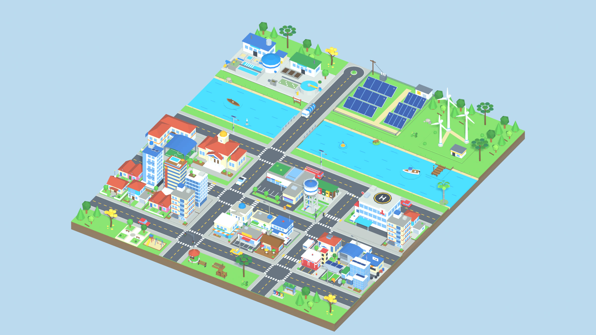

> **Resposta curta:** o Kit Cidade Low Poly é um pacote **gratuito e em domínio público (CC0 1.0)** com
> **129 modelos 3D low poly em glTF/GLB** para montar cidades em jogos e visualizações. Tem casas, comércio,
> serviços públicos, água e saneamento, energia renovável, resíduos, parques, ruas e terreno modulares
> (tiles 2 × 2), veículos, mobiliário urbano, árvores nativas brasileiras (ipê-amarelo, araucária, buriti) e
> beira de rio. Cores chapadas, sem texturas, até 1.500 triângulos por modelo. Funciona em Godot, Unity,
> Unreal, three.js, Babylon.js e Blender. Pode usar em projeto comercial, e dar crédito é opcional.

Modelos 3D low poly **livres** para montar cidades: casas, comércio, serviços públicos, água e saneamento,
energia, resíduos, parques, ruas e terreno modulares, veículos, mobiliário urbano, vegetação nativa brasileira
e beira de rio. Tudo em **glTF binário (`.glb`)**, com cores chapadas e sem texturas, pronto para Godot, Unity,
Unreal, Babylon.js, three.js, Blender e afins.

**Domínio público ([CC0 1.0](LICENSE)).** Use como quiser, em projetos pessoais, educativos ou comerciais,
modifique e redistribua. Dar crédito é opcional (veja [CITATION.cff](CITATION.cff)). Sem nenhuma garantia.

**Conteúdo:** [Como usar](#como-usar) · [Catálogo](#catálogo) · [Como gerar ou modificar](#como-gerar-ou-modificar) ·
[Perguntas frequentes](#perguntas-frequentes) · [Origem e créditos](#origem-e-créditos)

## Como usar

- Baixe o repositório (botão **Code → Download ZIP**) ou só os `.glb` de que precisar em [`models/`](models).
- **Escala e grade:** 1 lote = 2 × 2 unidades. Prédios ocupam N × N lotes; ruas e terreno são peças de
  exatamente 2 × 2 que se encaixam lado a lado; veículos, props e mobiliário estão numa escala "de brinquedo"
  que conversa com esses lotes.
- **Orientação:** Y para cima, frente dos modelos voltada para **-Z** (convenção glTF).
- **Materiais:** um material por cor (PBR, só cor base, rugosidade 0,85). Para juntar tudo num draw call,
  converta as cores dos materiais em cor de vértice na sua engine.
- **Partes animáveis:** objetos chamados `pas_N` (rotores, giram no eixo do cubo) e `gira_N` (giram em pé)
  ficam separados do corpo, com o pivô no lugar.
- **Orçamento:** no máximo 1.500 triângulos e 150 KB por modelo.

### Ruas e terreno modulares

As peças de `ruas/` e `terreno/` ocupam exatamente x, z ∈ [-1, 1] e se encaixam numa grade de 2 unidades,
girando em múltiplos de 90° em Y. Medidas em glTF (Y para cima):

| Elemento | Medida |
|---|---|
| Bloco de terreno | de y -0,3 a 0 (topo da grama em 0); as ruas já trazem o bloco embaixo e **substituem** o tile de terreno |
| Asfalto | 1,3 de largura centrada (\|x\| ≤ 0,65), topo em y 0,04, faixa amarela tracejada no eixo |
| Meio-fio e calçada | meio-fio com topo em 0,075; calçada de \|x\| 0,65 a 1,0 com topo em 0,07 |
| Estrada de terra | mesma largura do asfalto, topo em y 0,02, sem calçada |
| Água | superfície em y -0,12; margem de areia em degrau a y -0,06 |
| Morro | topo em y 0,6; `rampa` sobe de 0 (borda -Z) a 0,6 (borda +Z) |

Conexões sem rotação: `asfalto_reta`, `asfalto_faixa_pedestre`, `terra_reta` e `ponte` ligam -Z e +Z;
`asfalto_curva` e `terra_curva` ligam -Z e -X; `asfalto_t` liga -Z, +Z e -X; `asfalto_ponta` só -Z;
`estacionamento` abre para -Z; `margem_reta` tem a água na metade -Z; `margem_canto` tem a água num quarto de
círculo no canto (+X, -Z). Veja um bairro montado em [`src/cena_cidade.py`](src/cena_cidade.py).

## Catálogo

<!-- catalogo:inicio -->
**129 modelos** em 14 categorias.

### Residencial · Residential (5)

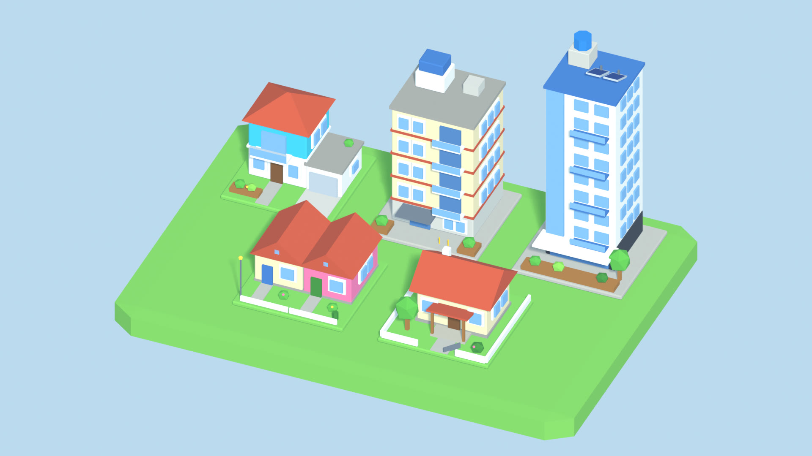

| | Modelo | Descrição | Tris |
|---|---|---|---:|
| 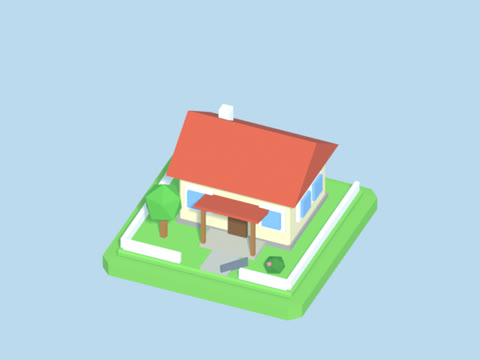 | [`casa_simples`](models/residencial/casa_simples.glb) | Casa simples (1×1) | 584 |
| 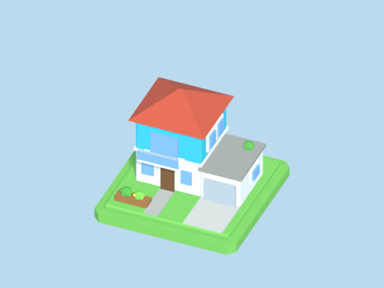 | [`casa_sobrado`](models/residencial/casa_sobrado.glb) | Sobrado (1×1) | 564 |
| 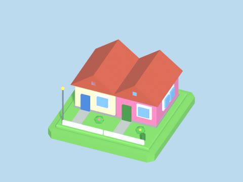 | [`casas_geminadas`](models/residencial/casas_geminadas.glb) | Casas geminadas (1×1) | 588 |
| 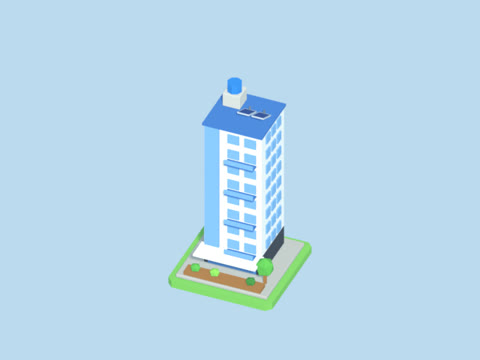 | [`predio_alto`](models/residencial/predio_alto.glb) | Prédio alto residencial (1×1) | 1008 |
| 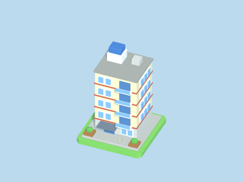 | [`predio_apartamentos`](models/residencial/predio_apartamentos.glb) | Prédio de apartamentos (1×1) | 1208 |

### Comércio · Commercial (8)

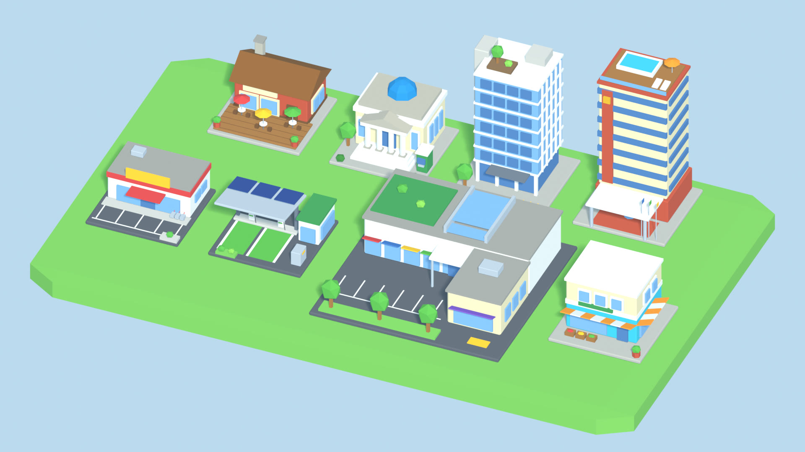

| | Modelo | Descrição | Tris |
|---|---|---|---:|
| 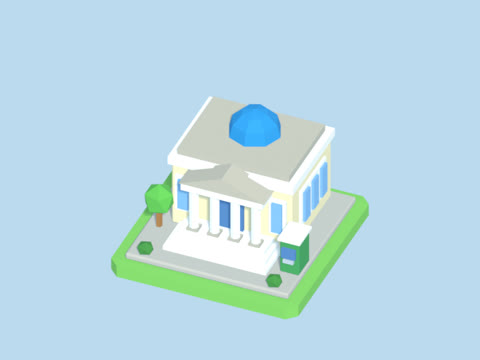 | [`banco`](models/comercial/banco.glb) | Agência bancária (1×1) | 662 |
| 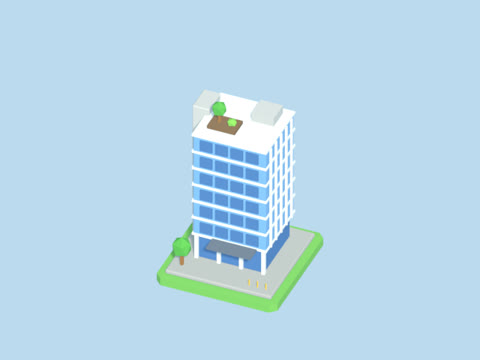 | [`escritorio`](models/comercial/escritorio.glb) | Prédio de escritórios (1×1) | 820 |
| 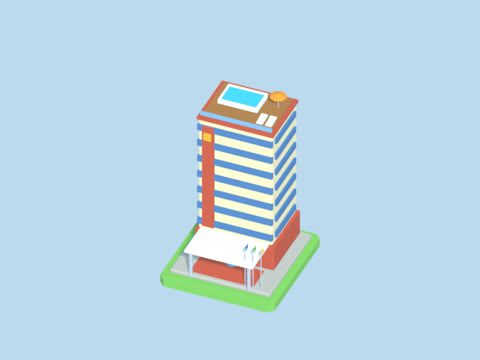 | [`hotel`](models/comercial/hotel.glb) | Hotel (1×1) | 678 |
| 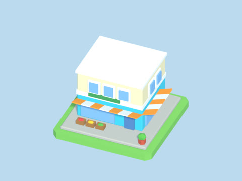 | [`loja_esquina`](models/comercial/loja_esquina.glb) | Loja de esquina (1×1) | 652 |
| 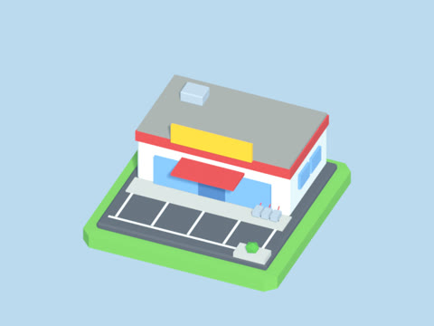 | [`mercado`](models/comercial/mercado.glb) | Mercado de bairro (1×1) | 512 |
| 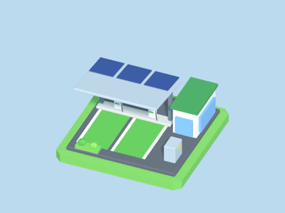 | [`posto_recarga`](models/comercial/posto_recarga.glb) | Posto de recarga de carros elétricos (1×1) | 636 |
| 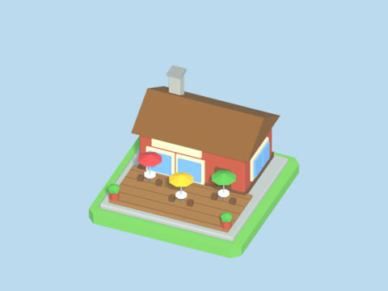 | [`restaurante`](models/comercial/restaurante.glb) | Restaurante (1×1) | 738 |
| 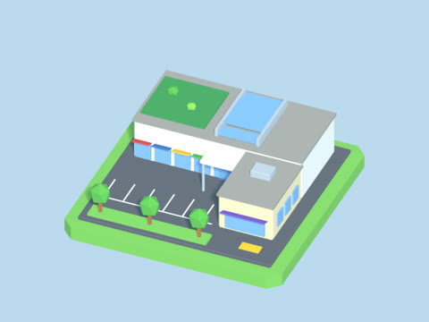 | [`shopping`](models/comercial/shopping.glb) | Shopping (2×2) | 796 |

### Serviços públicos · Public services (12)

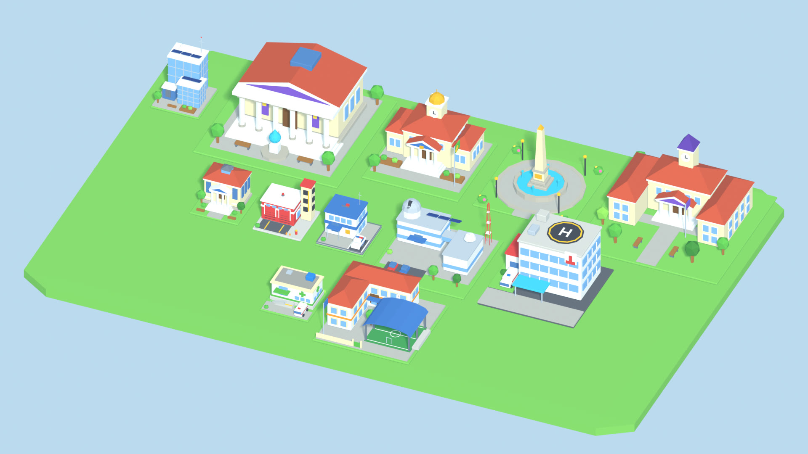

| | Modelo | Descrição | Tris |
|---|---|---|---:|
| 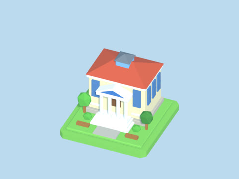 | [`biblioteca`](models/publicos/biblioteca.glb) | Biblioteca Pública (1×1) | 812 |
| 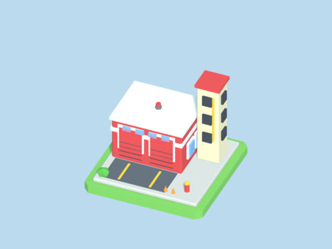 | [`bombeiros`](models/publicos/bombeiros.glb) | Corpo de Bombeiros (1×1) | 670 |
| 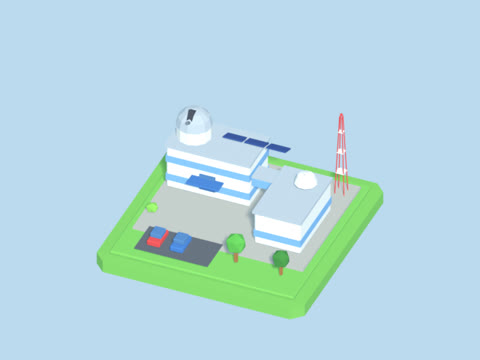 | [`centro_pesquisa`](models/publicos/centro_pesquisa.glb) | Centro de Pesquisa (2×2) | 952 |
| 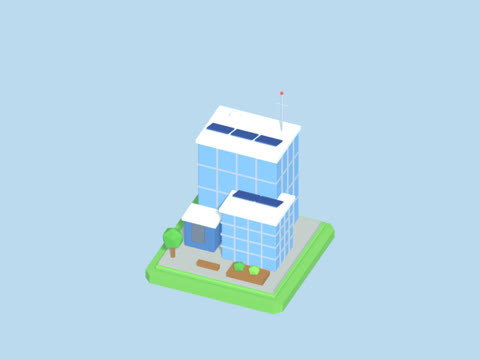 | [`centro_tecnologia`](models/publicos/centro_tecnologia.glb) | Centro de Tecnologia (1×1) | 686 |
| 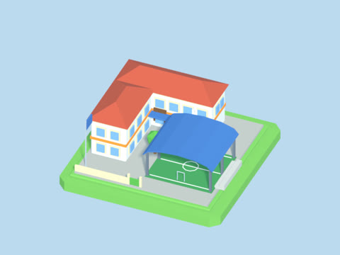 | [`escola`](models/publicos/escola.glb) | Escola (2×2) | 1328 |
|  | [`hospital`](models/publicos/hospital.glb) | Hospital (2×2) | 1224 |
| 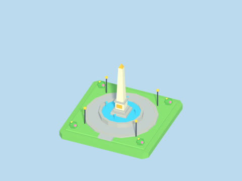 | [`monumento`](models/publicos/monumento.glb) | Monumento Histórico (2×2) | 1154 |
| 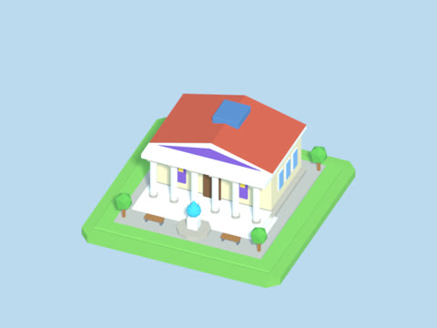 | [`museu`](models/publicos/museu.glb) | Museu (3×3) | 1238 |
| 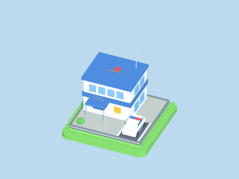 | [`policia`](models/publicos/policia.glb) | Delegacia / Base da Polícia (1×1) | 772 |
| 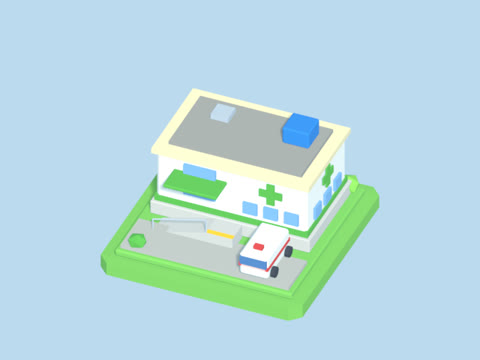 | [`posto_saude`](models/publicos/posto_saude.glb) | Posto de Saúde / UBS (1×1) | 724 |
| 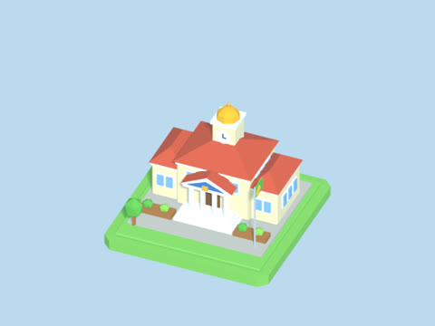 | [`prefeitura`](models/publicos/prefeitura.glb) | Prefeitura Municipal (2×2) | 1146 |
| 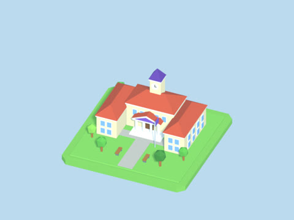 | [`universidade`](models/publicos/universidade.glb) | Universidade (3×3) | 1352 |

### Indústria · Industry (4)

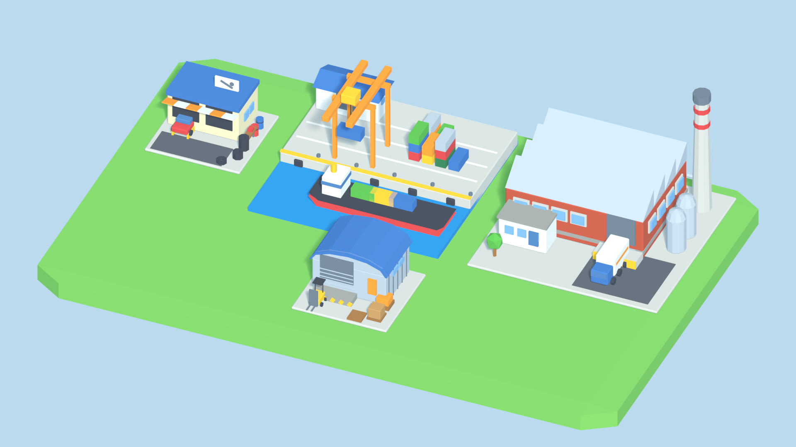

| | Modelo | Descrição | Tris |
|---|---|---|---:|
| 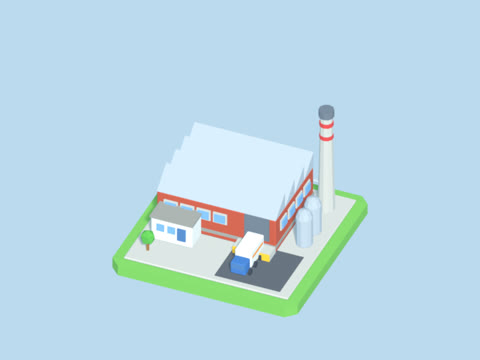 | [`fabrica`](models/industrial/fabrica.glb) | Fábrica (2×2) | 1372 |
| 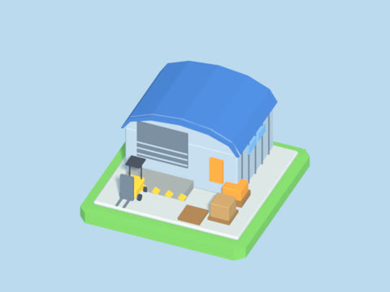 | [`galpao`](models/industrial/galpao.glb) | Galpão / Armazém (1×1) | 748 |
| 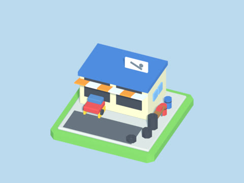 | [`oficina`](models/industrial/oficina.glb) | Oficina Mecânica (1×1) | 1164 |
| 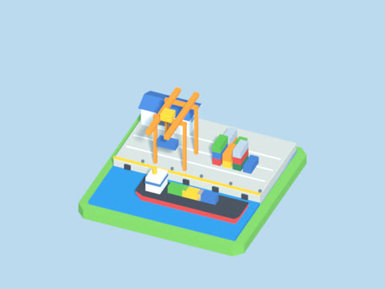 | [`porto`](models/industrial/porto.glb) | Porto (2×2, sobre a água) | 1020 |

### Água e saneamento · Water and sanitation (16)

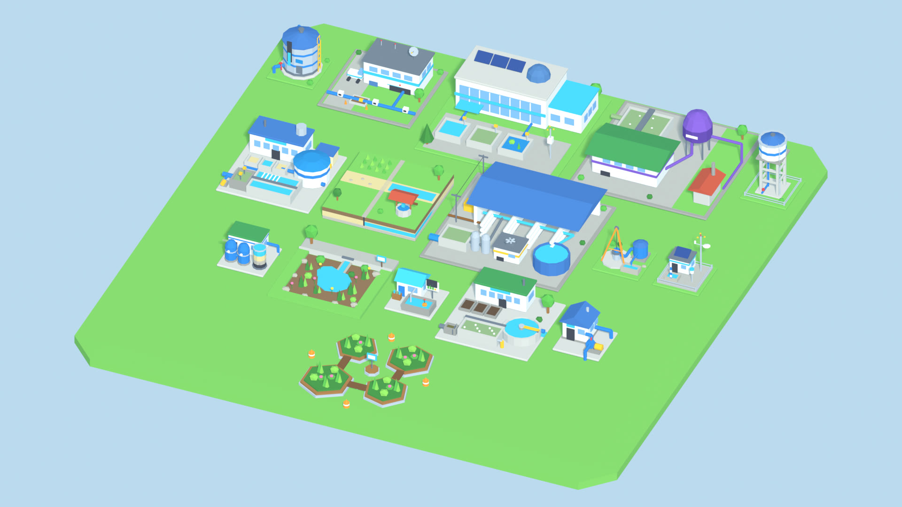

| | Modelo | Descrição | Tris |
|---|---|---|---:|
| 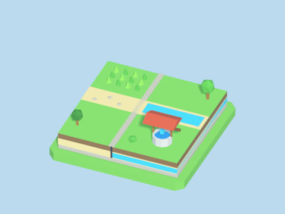 | [`barragem_subterranea`](models/agua/barragem_subterranea.glb) | Barragem Subterrânea (2×2) | 592 |
| 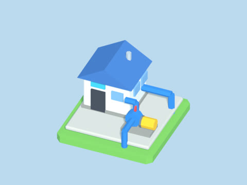 | [`bomba_agua`](models/agua/bomba_agua.glb) | Bomba de Água (1×1) | 440 |
| 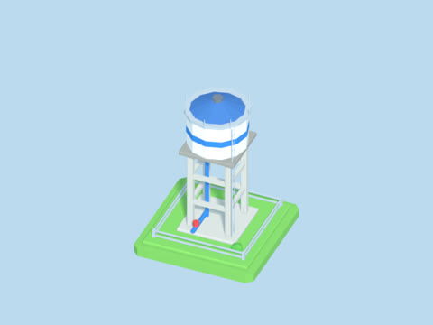 | [`caixa_dagua`](models/agua/caixa_dagua.glb) | Caixa-d'Água Elevada (1×1) | 1232 |
| 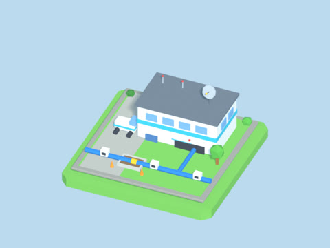 | [`centro_controle_perdas`](models/agua/centro_controle_perdas.glb) | Centro de Controle de Perdas (2×2) | 964 |
| 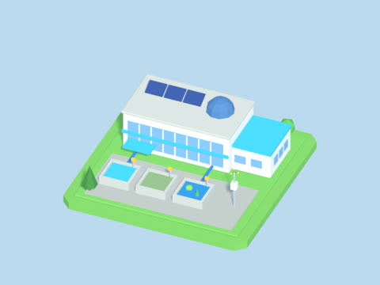 | [`centro_pesquisa_agua`](models/agua/centro_pesquisa_agua.glb) | Centro de Pesquisas Hídricas (3×3) | 1112 |
| 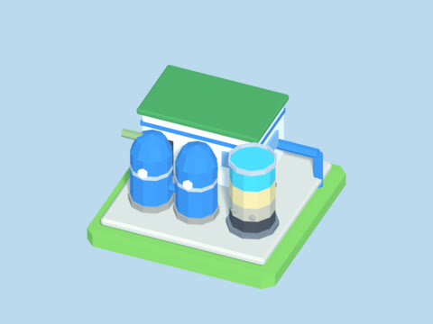 | [`estacao_filtragem`](models/agua/estacao_filtragem.glb) | Estação de Filtros (1×1) | 984 |
| 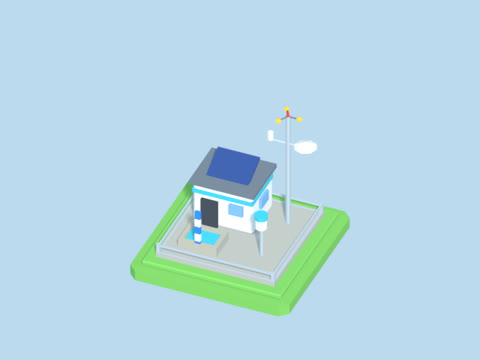 | [`estacao_monitoramento`](models/agua/estacao_monitoramento.glb) | Estação de Monitoramento (1×1) | 684 |
| 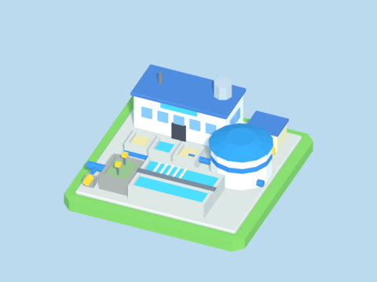 | [`eta`](models/agua/eta.glb) | Estação de Tratamento de Água — ETA (2×2) | 1268 |
| 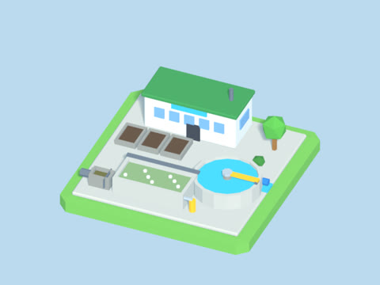 | [`ete`](models/agua/ete.glb) | Estação de Tratamento de Esgoto — ETE (2×2) | 1232 |
| 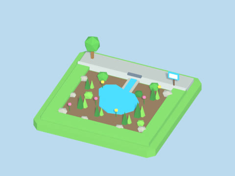 | [`jardim_chuva`](models/agua/jardim_chuva.glb) | Jardim de Chuva (2×2) | 776 |
| 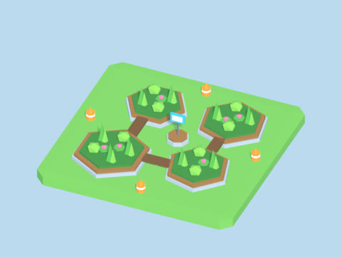 | [`jardim_flutuante`](models/agua/jardim_flutuante.glb) | Jardim Flutuante (3×3, sobre a água) | 1212 |
| 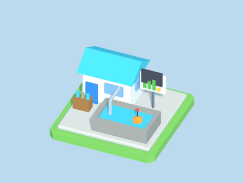 | [`monitor_qualidade_agua`](models/agua/monitor_qualidade_agua.glb) | Monitor de Qualidade (1×1) | 508 |
| 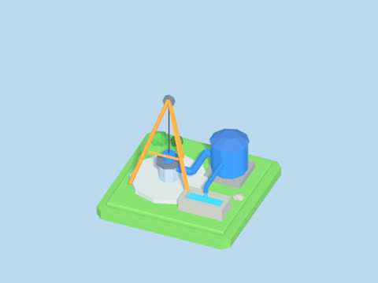 | [`poco_artesiano`](models/agua/poco_artesiano.glb) | Poço Artesiano (1×1) | 656 |
| 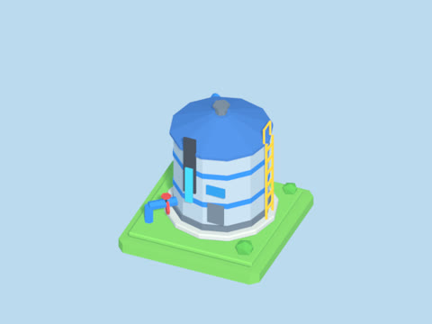 | [`reservatorio`](models/agua/reservatorio.glb) | Reservatório (1×1) | 868 |
| 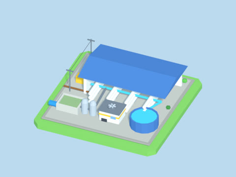 | [`usina_dessalinizacao`](models/agua/usina_dessalinizacao.glb) | Usina de Dessalinização (3×3) | 1468 |
| 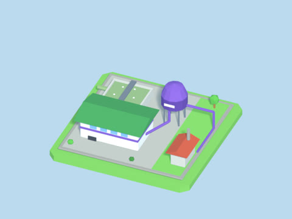 | [`usina_reuso_agua`](models/agua/usina_reuso_agua.glb) | Estação de Água de Reúso (3×3) | 938 |

### Energia · Energy (11)


| | Modelo | Descrição | Tris |
|---|---|---|---:|
|  | [`biodigestor`](models/energia/biodigestor.glb) | Biodigestor (2×2) | 1408 |
|  | [`hidreletrica`](models/energia/hidreletrica.glb) | Hidrelétrica (3×3, sobre a água) | 972 |
|  | [`parque_eolico`](models/energia/parque_eolico.glb) | Campo Eólico (2×2) | 846 |
|  | [`poste_energia`](models/energia/poste_energia.glb) | Poste de Energia (1×1) | 264 |
|  | [`termeletrica`](models/energia/termeletrica.glb) | Termelétrica (2×2) | 844 |
|  | [`usina_biomassa`](models/energia/usina_biomassa.glb) | Usina de Biomassa (2×2) | 1056 |
|  | [`usina_cana`](models/energia/usina_cana.glb) | Usina Sucroenergética (3×3) | 1440 |
|  | [`usina_carvao`](models/energia/usina_carvao.glb) | Usina a Carvão (2×2) | 512 |
|  | [`usina_mare`](models/energia/usina_mare.glb) | Usina Maremotriz (2×2, sobre a água) | 640 |
|  | [`usina_nuclear`](models/energia/usina_nuclear.glb) | Usina Nuclear (4×4) | 1488 |
|  | [`usina_solar`](models/energia/usina_solar.glb) | Usina Solar (3×3) | 944 |

### Resíduos · Waste and recycling (4)


| | Modelo | Descrição | Tris |
|---|---|---|---:|
|  | [`aterro_sanitario`](models/residuos/aterro_sanitario.glb) | Aterro Sanitário (3×3) | 1482 |
|  | [`cooperativa_reciclagem`](models/residuos/cooperativa_reciclagem.glb) | Cooperativa de Reciclagem (2×2) | 1302 |
|  | [`patio_compostagem`](models/residuos/patio_compostagem.glb) | Pátio de Compostagem (2×2) | 1158 |
|  | [`ponto_coleta`](models/residuos/ponto_coleta.glb) | Ponto de Coleta Reciclável / PEV (1×1) | 832 |

### Parques · Parks (5)


| | Modelo | Descrição | Tris |
|---|---|---|---:|
|  | [`ecoparque`](models/parques/ecoparque.glb) | Ecoparque (3×3) | 1480 |
|  | [`parede_verde`](models/parques/parede_verde.glb) | Parede Verde (1×1) | 876 |
|  | [`parque`](models/parques/parque.glb) | Parque Turístico (4×4) | 1484 |
|  | [`parque_linear`](models/parques/parque_linear.glb) | Parque Linear (3×3) | 900 |
|  | [`telhado_verde`](models/parques/telhado_verde.glb) | Teto Verde (2×2) | 1332 |

### Ruas (peças modulares 2 × 2) · Roads (modular 2 × 2 tiles) (12)


| | Modelo | Descrição | Tris |
|---|---|---|---:|
|  | [`asfalto_cruzamento`](models/ruas/asfalto_cruzamento.glb) | Cruzamento de asfalto (tile 2×2) | 492 |
|  | [`asfalto_curva`](models/ruas/asfalto_curva.glb) | Rua de asfalto em curva (tile 2×2) | 548 |
|  | [`asfalto_faixa_pedestre`](models/ruas/asfalto_faixa_pedestre.glb) | Rua de asfalto reta com faixa de pedestres (tile 2×2) | 228 |
|  | [`asfalto_ponta`](models/ruas/asfalto_ponta.glb) | Fim de rua com balão de retorno (tile 2×2) | 524 |
|  | [`asfalto_reta`](models/ruas/asfalto_reta.glb) | Rua de asfalto reta (tile 2×2) | 132 |
|  | [`asfalto_t`](models/ruas/asfalto_t.glb) | Entroncamento em T de asfalto (tile 2×2) | 264 |
|  | [`calcada`](models/ruas/calcada.glb) | Calçada (tile 2×2) | 108 |
|  | [`estacionamento`](models/ruas/estacionamento.glb) | Estacionamento (tile 2×2) | 320 |
|  | [`ponte`](models/ruas/ponte.glb) | Ponte de concreto (tile 2×2, substitui um tile de água) | 428 |
|  | [`praca`](models/ruas/praca.glb) | Praça (tile 2×2) | 496 |
|  | [`terra_curva`](models/ruas/terra_curva.glb) | Estrada de terra em curva (tile 2×2) | 484 |
|  | [`terra_reta`](models/ruas/terra_reta.glb) | Estrada de terra reta (tile 2×2) | 160 |

### Terreno (peças modulares 2 × 2) · Terrain (modular 2 × 2 tiles) (9)


| | Modelo | Descrição | Tris |
|---|---|---|---:|
|  | [`agua`](models/terreno/agua.glb) | Água (tile 2×2) | 48 |
|  | [`areia`](models/terreno/areia.glb) | Terreno de areia (tile 2×2) | 90 |
|  | [`arvores_mata`](models/terreno/arvores_mata.glb) | Mata (tile 2×2) | 208 |
|  | [`grama`](models/terreno/grama.glb) | Terreno de grama (tile 2×2) | 24 |
|  | [`margem_canto`](models/terreno/margem_canto.glb) | Margem em canto (tile 2×2) | 320 |
|  | [`margem_reta`](models/terreno/margem_reta.glb) | Margem reta de rio (tile 2×2) | 148 |
|  | [`morro`](models/terreno/morro.glb) | Morro (tile 2×2) | 108 |
|  | [`rampa`](models/terreno/rampa.glb) | Rampa de terreno (tile 2×2) | 56 |
|  | [`terra`](models/terreno/terra.glb) | Terreno de terra batida (tile 2×2) | 144 |

### Veículos · Vehicles (10)


| | Modelo | Descrição | Tris |
|---|---|---|---:|
|  | [`ambulancia`](models/veiculos/ambulancia.glb) | Ambulância (furgão) | 624 |
|  | [`bicicleta`](models/veiculos/bicicleta.glb) | Bicicleta solta | 332 |
|  | [`caminhao`](models/veiculos/caminhao.glb) | Caminhão baú | 676 |
|  | [`caminhao_bombeiros`](models/veiculos/caminhao_bombeiros.glb) | Caminhão de bombeiros | 1028 |
|  | [`caminhao_lixo`](models/veiculos/caminhao_lixo.glb) | Caminhão de lixo (coletor compactador) | 616 |
|  | [`caminhao_pipa`](models/veiculos/caminhao_pipa.glb) | Caminhão-pipa | 856 |
|  | [`carro`](models/veiculos/carro.glb) | Carro hatch vermelho | 464 |
|  | [`carro_eletrico`](models/veiculos/carro_eletrico.glb) | Carro elétrico | 488 |
|  | [`onibus`](models/veiculos/onibus.glb) | Ônibus urbano | 616 |
|  | [`taxi`](models/veiculos/taxi.glb) | Táxi | 520 |

### Mobiliário urbano · Street furniture (20)


| | Modelo | Descrição | Tris |
|---|---|---|---:|
|  | [`banco_praca`](models/mobiliario/banco_praca.glb) | Banco de praça | 420 |
|  | [`barril_chuva`](models/mobiliario/barril_chuva.glb) | Barril de captação de chuva | 672 |
|  | [`bebedouro`](models/mobiliario/bebedouro.glb) | Bebedouro público | 472 |
|  | [`bicicletario`](models/mobiliario/bicicletario.glb) | Bicicletário | 476 |
|  | [`cerca_madeira`](models/mobiliario/cerca_madeira.glb) | Cerca de madeira (trecho de 2 unidades ao longo de X) | 348 |
|  | [`cisterna`](models/mobiliario/cisterna.glb) | Cisterna de placas (semiárido) | 600 |
|  | [`hidrante`](models/mobiliario/hidrante.glb) | Hidrante de rua | 422 |
|  | [`lixeira`](models/mobiliario/lixeira.glb) | Lixeira comum de calçada (papeleira) | 284 |
|  | [`lixeira_seletiva`](models/mobiliario/lixeira_seletiva.glb) | Lixeira seletiva de rua | 936 |
|  | [`orelhao`](models/mobiliario/orelhao.glb) | Orelhão (telefone público brasileiro) | 276 |
|  | [`parquinho`](models/mobiliario/parquinho.glb) | Parquinho | 596 |
|  | [`placa_educativa`](models/mobiliario/placa_educativa.glb) | Placa educativa de beira de rio | 274 |
|  | [`placa_pare`](models/mobiliario/placa_pare.glb) | Placa de parada obrigatória | 136 |
|  | [`ponto_onibus`](models/mobiliario/ponto_onibus.glb) | Ponto de ônibus com telhado verde | 480 |
|  | [`poste_luz`](models/mobiliario/poste_luz.glb) | Poste de iluminação comum | 236 |
|  | [`poste_solar`](models/mobiliario/poste_solar.glb) | Poste solar | 320 |
|  | [`quiosque`](models/mobiliario/quiosque.glb) | Quiosque de praça | 462 |
|  | [`semaforo`](models/mobiliario/semaforo.glb) | Semáforo veicular de esquina | 480 |
|  | [`semaforo_pedestre`](models/mobiliario/semaforo_pedestre.glb) | Semáforo de pedestre | 212 |
|  | [`vaso_planta`](models/mobiliario/vaso_planta.glb) | Floreira de concreto de calçada | 328 |

### Vegetação · Vegetation (7)


| | Modelo | Descrição | Tris |
|---|---|---|---:|
|  | [`araucaria`](models/vegetacao/araucaria.glb) | Araucária (pinheiro-do-paraná) | 548 |
|  | [`arbustos`](models/vegetacao/arbustos.glb) | Conjunto de arbustos para canteiro | 200 |
|  | [`buriti`](models/vegetacao/buriti.glb) | Buriti (palmeira das veredas) | 636 |
|  | [`composteira`](models/vegetacao/composteira.glb) | Composteira de dois módulos de ripas de madeira | 1332 |
|  | [`horta`](models/vegetacao/horta.glb) | Canteiro de horta comunitária | 494 |
|  | [`ipe_amarelo`](models/vegetacao/ipe_amarelo.glb) | Ipê-amarelo (árvore nativa) | 388 |
|  | [`pedras`](models/vegetacao/pedras.glb) | Conjunto de pedras de beira de rio | 108 |

### Beira-rio · Riverside (6)


| | Modelo | Descrição | Tris |
|---|---|---|---:|
|  | [`barco_pesca`](models/beira_rio/barco_pesca.glb) | Barco de pesca pequeno a motor sobre um pedaço de água | 412 |
|  | [`boia_rio`](models/beira_rio/boia_rio.glb) | Boia de monitoramento do rio | 364 |
|  | [`canoa`](models/beira_rio/canoa.glb) | Canoa de madeira de pescador num remanso do rio | 296 |
|  | [`capivara`](models/beira_rio/capivara.glb) | Capivara estilizada num pedaço de grama da margem | 300 |
|  | [`garca`](models/beira_rio/garca.glb) | Garça-branca em pé numa pedra da beira do rio | 222 |
|  | [`trapiche`](models/beira_rio/trapiche.glb) | Trapiche (píer curto de madeira) | 570 |

<!-- catalogo:fim -->

## Como gerar ou modificar

Cada modelo é um script Python em `src/<categoria>/<id>.py` que usa as peças da biblioteca [`src/lib.py`](src/lib.py)
(caixas, cilindros, canos, telhados, janelas, árvores…) e a paleta de cores única. Precisa do Blender 4.5 LTS.

```bash
blender -b --factory-startup --python src/agua/eta.py                 # um modelo → models/agua/eta.glb
blender -b --factory-startup --python src/gerar_todos.py              # todos (+ models/catalogo.json)
blender -b --factory-startup --python src/gerar_todos.py -- ruas      # só uma categoria
blender -b --factory-startup --python src/vitrine.py -- tudo --cada   # imagens em previews/
blender -b --factory-startup --python src/cena_cidade.py              # previews/capa.jpg (bairro de exemplo)
py -3 tools/atualizar_readme.py                                       # refaz o catálogo acima
```

Para criar um modelo novo: copie um script parecido, monte a peça com a **frente para -Y do Blender** (o
`exportar` gira 180° para a frente ficar em -Z no glTF) e use só cores de `PALETA`.

## Perguntas frequentes

**Posso usar os modelos num jogo comercial?**
Pode. Tudo está em domínio público (CC0 1.0): uso comercial, modificação e redistribuição liberados, sem pedir
autorização e sem pagar nada.

**Preciso dar crédito?**
Não. A atribuição é opcional. Se quiser citar, os dados estão em [CITATION.cff](CITATION.cff).

**Em que formato estão os modelos?**
glTF binário (`.glb`), com Y para cima, frente para -Z e um material PBR por cor (só cor base, sem texturas
nem UV).

**Funciona no Godot, no Unity, no Unreal e no three.js?**
Funciona. O `.glb` abre direto no Godot 4, no three.js (`GLTFLoader`), no Babylon.js, no Blender e no Unreal 5
(Interchange). No Unity, use o pacote glTFast.

**Qual é a escala?**
1 lote = 2 × 2 unidades. Os prédios ocupam N × N lotes, e as peças de rua e de terreno têm exatamente 2 × 2
para encaixar numa grade.

**Os modelos são leves para celular e web?**
São. Cada modelo tem no máximo 1.500 triângulos e 150 KB, sem texturas. Juntando os materiais em cor de
vértice, um bairro inteiro cabe em poucas chamadas de desenho.

**Posso pedir ou criar um modelo novo?**
Pode. Cada modelo é um script Python curto no Blender (veja [Como gerar ou modificar](#como-gerar-ou-modificar)).
Para pedir um modelo, abra uma issue.

## Origem e créditos

O kit nasceu dos modelos próprios do jogo educativo [Guardião da Água](https://github.com/kayquer/guardiao_da_agua_js),
produto da pesquisa de mestrado de Cláudia Dias Roxinol (Unesp, Presidente Prudente), desenvolvido com Kayque
Rotondo. Os modelos e scripts foram feitos com o Blender e com o Claude (Anthropic) como assistente. Nenhum modelo
de terceiros faz parte deste repositório.
